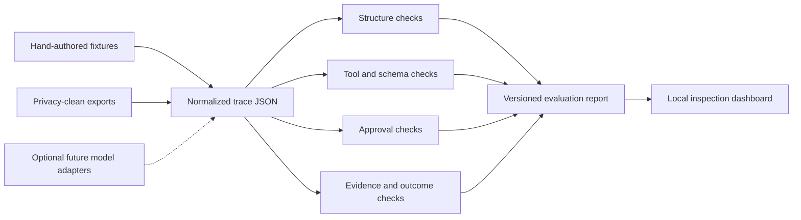
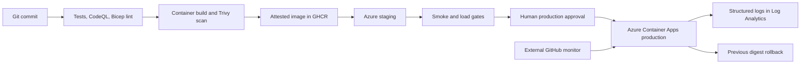

# Architecture

## Design decisions

### Model-independent core

The evaluator consumes trace JSON rather than invoking a model. This makes every check reproducible on an ordinary laptop and avoids coupling the project to a provider, free tier, or GPU.

### Explicit provenance

Every trace includes a provenance statement. The bundled traces are hand-authored scenarios, and intentionally failing cases say so directly. Future exports must remove prompts, file paths, identifiers, and other private data before entering the repository.

### Narrow evaluation claims

The evaluator verifies declarations that code can check deterministically. It does not infer whether a response is generally helpful, safe, or semantically entailed. Evidence checks currently confirm only that each declared claim points to an existing tool-result value.

### No execution of submitted tools

The `POST /api/evaluate` endpoint accepts trace data only. It never imports code or runs the tools named in a trace. The request body is bounded to 200 KB.

## Delivery and operating architecture

The Bicep deployment creates isolated staging or production resources with managed HTTPS ingress, bounded scaling, health probes, and centralized logs. GitHub authenticates to Azure through short-lived OpenID Connect credentials. Production accepts only an immutable GHCR digest, and the protected GitHub environment provides the human approval boundary.

The design is deployable but is not considered operationally proven until the real Azure deployment, monitoring window, and rollback exercise are recorded in `PRODUCTION_READINESS.md`.

## Next evaluation milestone

The next milestone is a versioned JSON Schema plus a privacy-clean exporter for Support Agent Lab. That will prove the format against a real project while keeping the evaluator itself independent of any model.
